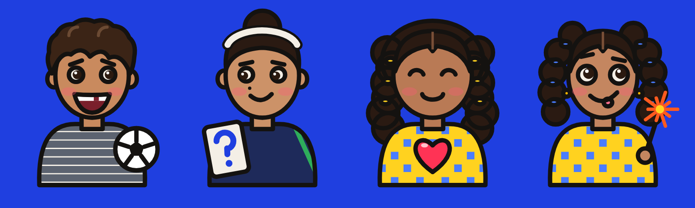
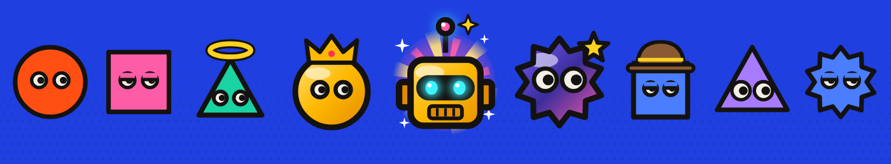
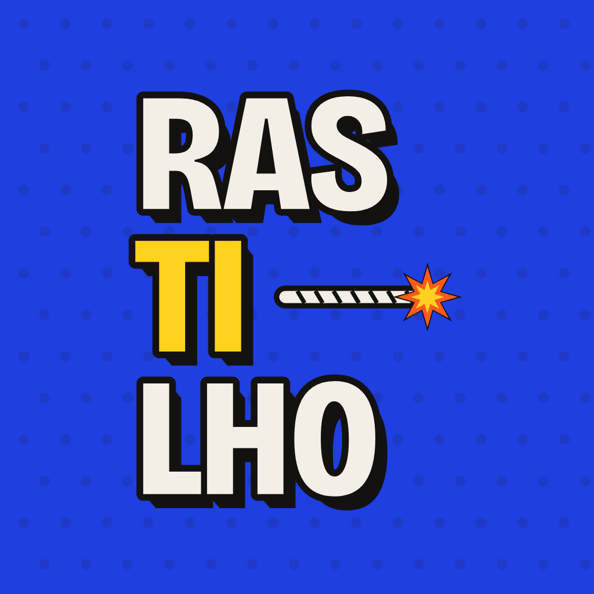

  

  
  
  

## 🧨 Que jogo é esse?

Sabe aquela brincadeira de adivinhar alguma coisa pelas dicas? O Rastilho é isso, só que com pavio aceso.

Uma carta sai com um tema surpresa e as pistas vão aparecendo, uma de cada vez. A primeira é bem misteriosa. A última praticamente entrega a resposta. A graça está em arriscar antes de todo mundo: **quanto mais cedo você acerta, mais longe você anda na trilha.** Quem chega primeiro ao fim e acerta a carta final leva a partida.

Dá pra jogar com os amigos no sofá, cada um no seu celular, ou desafiar a Turma quando não tem ninguém por perto.

## 🔥 Bora testar?

Aqui vai uma carta de verdade. Abra uma pista por vez e veja em qual você acertaria.

> **Tema: Objeto**

<b>🔥 Pista 1</b>

 
Cabe na palma da mão.

<b>🔥 Pista 2</b>

 
Não precisa de pilha.

<b>🔥 Pista 3</b>

 
Foi inventada na China.

<b>🔥 Pista 4</b>

 
Era indispensável nas Grandes Navegações.

<b>🔥 Pista 5</b>

 
Tem uma agulha imantada.

<b>💥 Mostrar a resposta</b>

 

### Bússola! 🧭

Acertou logo na primeira pista? No jogo isso vale casas de bônus. Acertou só no fim? Tudo bem, o importante é não deixar o pavio apagar. 😄

## 🎲 Jeitos de jogar

| | |
|:--:|---|
| 🤖 **Sozinho** | Você contra a Turma, uma partida rapidinha pra aquecer. |
| 🛋️ **Com amigos** | Cria uma sala, manda o código e pronto: todo mundo na mesma mesa. |
| 🌎 **Online** | Cai numa partida com quem estiver jogando agora. |
| 🏆 **Ranqueada** | Vale pontos no ranking da temporada. Aqui o bicho pega. |

No meio do caminho ainda aparecem casas de desafio, minijogos e umas cartas especiais pra bagunçar a vida dos outros. O resto você descobre jogando. 😉

## 👋 Conheça a Turma

  

Eles moram dentro do jogo e topam qualquer partida.

**Ian** adora um desafio e chuta com confiança. **Kim** é caprichosa e só responde quando tem certeza. **Liz** é a mais tranquila da mesa. **Lena** é pura energia e às vezes chuta no escuro. Ganhar de cada um deles rende uma surpresa.

## ✨ Carinhas pra colecionar

  

Cada jogador escolhe a sua carinha. Algumas vêm de presente, outras você ganha jogando, e tem umas lendárias que dão um trabalhão pra conseguir. 👑

## 🚧 Onde está o jogo agora

O Rastilho está em fase de testes com um grupo pequeno de amigos. Ficou com vontade de testar também? Manda uma mensagem pra **rastilho.support@gmail.com** que a gente te chama. Quem testa agora ganha um robô lendário que ninguém mais vai ter. 🤫

## 🛠️ Quem faz o Rastilho

<table>
  <tr>
    <td align="center">
      <a href="https://github.com/guilherme-marinho">
         
        <b>Guilherme Marinho</b>
      </a>
    </td>
  </tr>
</table>

   
  Feito no Brasil, com muito café e muita pista. 🇧🇷

